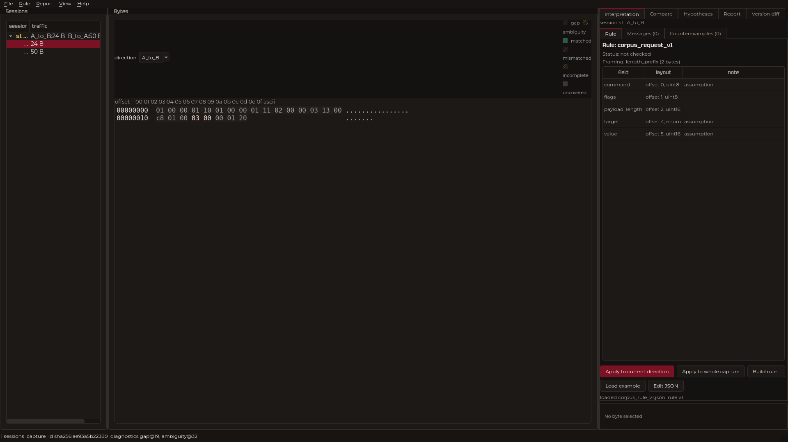
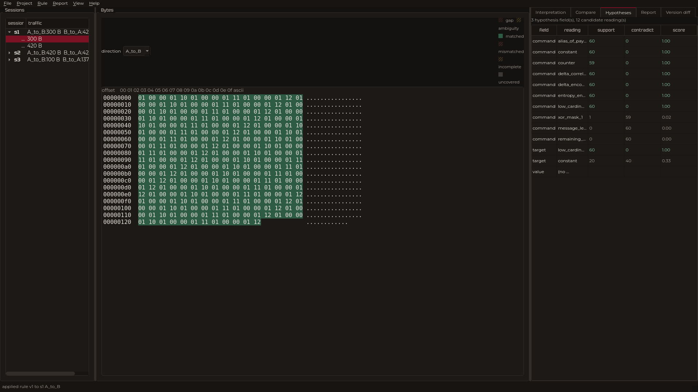
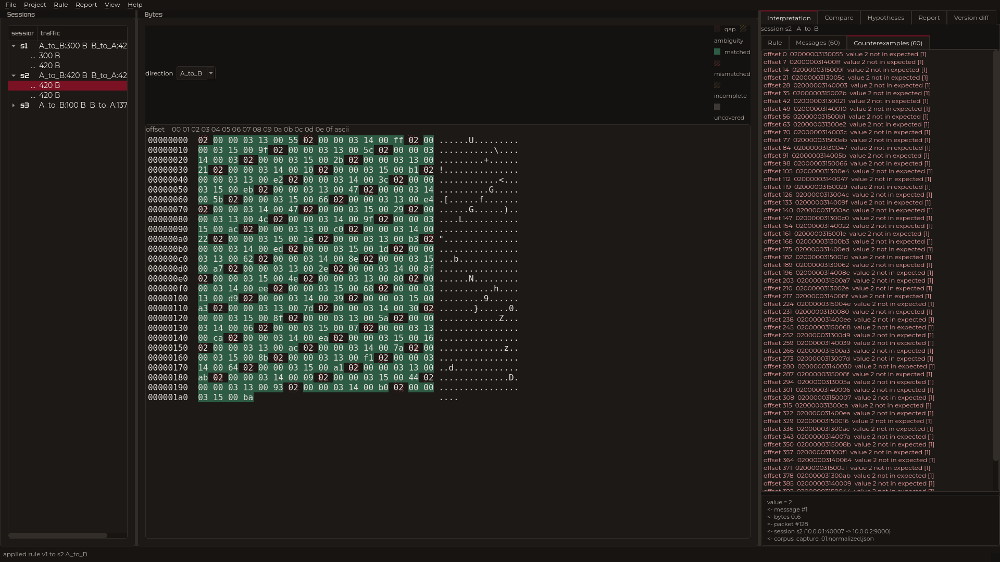
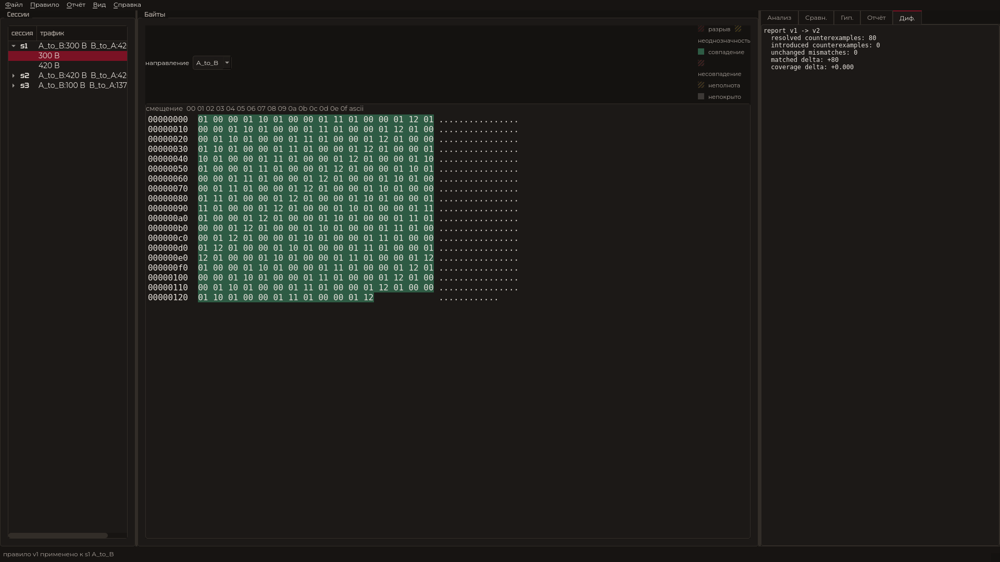
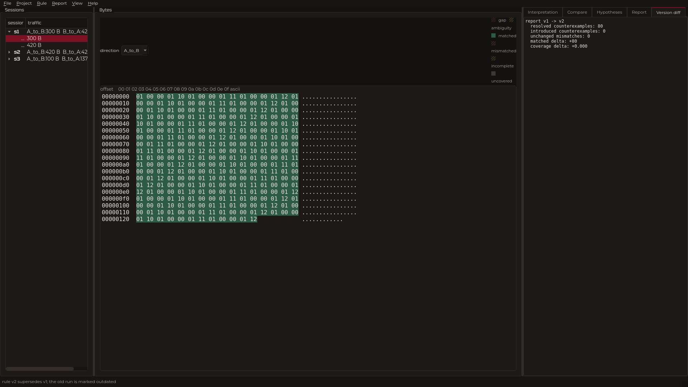

# A tool for investigating a binary protocol over TCP

A desktop application for dissecting an undocumented binary protocol over TCP. It opens a traffic
capture in PCAP or PCAPNG format, isolates TCP sessions, reassembles directed streams, shows bytes
linked to their packets, lets you put forward hypotheses about the message structure, apply
declarative interpretation rules, verify them against a corpus, find counterexamples and save the
whole investigation as a portable project with a report.

The main principle: a fact and a guess are never mixed. Every byte range in a reassembled stream is
linked to the packet that produced it; a gap or an ambiguous overlap is shown as it is rather than
filled in; a rule that agrees with the examples is reported as confirmed over the verified scope,
not as proven.

The interface is available in Russian and English (switched in the language menu, the choice is
remembered) and in a dark and a light theme ("View" menu, dark by default). Every command works
offline.

## Implemented functionality

- **Reading captures.** PCAP and PCAPNG, including several interface blocks, different link-layer
  types and timestamp parsing.
- **TCP sessions.** Identifying connections by address/port quadruples, tracking the opening, the
  close (FIN) and the reset (RST), and the ordering of the streams.
- **Stream reassembly.** Rebuilding each direction from sequence numbers, diagnosing gaps and
  ambiguous overlaps, and marking retransmissions.
- **Packet linkage.** For every byte of a reassembled stream a reference to the source packet is
  kept (number, file, offset, timestamp).
- **Normalised export.** A single JSON contract between all stages (`docs/CONTRACT.md`), usable by
  external tools.
- **Streaming mode.** Normalising large captures without holding the whole file in memory.
- **Export to Wireshark.** Writing reassembled streams back into a pcap.
- **Message framing.** Several strategies for finding message boundaries (length prefix,
  delimiter, fixed size, length from the end).
- **Declarative rules.** Describing the message structure in a versioned format; the engine applies
  a rule to a whole stream or corpus and produces a machine-readable result.
- **Field types.** Signed and unsigned integers, floating point numbers (`float`), variable length
  (`varint`), tag-length-value structures (`tlv`) and bit fields.
- **Machine-readable exports.** The result of applying a rule is written as a JSON contract, as
  line-by-line JSONL or as CSV by field columns.
- **Request and response pairs.** Messages in both directions are linked into exchanges with a
  stated confidence and the list of observations it is based on.
- **Researcher notes.** Annotations on a byte range are stored in the project (SQLite) and reach
  the report.
- **Verification and counterexamples.** Comparing a rule against the corpus, classifying messages
  (`matched`, `mismatched`, `incomplete`, `uncovered`) and showing the exact bytes that refute a
  hypothesis.
- **Versioning.** Rules and results are versioned; comparing two versions of a rule and two
  results is supported.
- **Alternative hypotheses.** The hypotheses panel scores competing readings of the fields over the
  whole corpus rather than over a single example.
- **A portable project.** An investigation is saved to disk as a directory with a manifest
  (relative paths and sha256), and is exported and imported as a zip archive with an integrity
  check.
- **Reports.** An investigation is rendered to Markdown and to a self-contained HTML page.
- **A graphical interface.** A session tree, a hex view linked to packets, message comparison, a
  rule and validation panel, a hypotheses panel, version comparison and a settings dialogue.
- **Interface and themes.** Russian and English, a dark and a light theme, font sizes, default
  directories and the logging level — in the settings dialogue.
- **A web interface (optional).** A local page over the same engines: sessions, a hex view with
  verdicts, rule application, byte provenance and an HTML report export. Only `127.0.0.1`, the
  state lives in memory.

## What makes this project distinctive

1. **A byte is always linked to a packet.** The provenance link is not a bolt-on but a property of
   the stream model itself: any byte can be expanded to the packet it came from. That makes a
   conclusion verifiable rather than plausible.
2. **A match is not treated as proof.** A rule that agrees with all the examples is reported as
   confirmed over the verified scope. The corpus deliberately contains a counterexample — a command
   that the narrow v1 rule did not allow and that refined the rule to v2.
3. **A gap is visible, not filled.** Gaps and ambiguous overlaps in a stream are not masked: they
   are shown as separate categories with coordinates and remain input data for the next step.

## The main technology stack

| Layer | Technologies |
| --- | --- |
| Language | Python 3.12+ |
| Interface | PySide6 6.8.1 (Qt 6), an in-house theme token set, the Tektur and Montserrat typefaces |
| Capture parsing | dpkt 1.9.8 |
| Rule configuration | JSON, JSON Schema (`jsonschema`) |
| Tests | pytest, pytest-cov |
| Code quality | ruff |
| Build | setuptools, PyInstaller, dpkg-deb, Docker |

The graphical interface, capture parsing, the rule engine and the reports do not depend on
third-party network services: the application is fully local.

### The rationale for the stack

Every choice below was made for the task's reference load (100 MiB, 250k packets, 1000 sessions,
8 GB of RAM) and for reproducibility on another machine.

- **Capture parsing — `dpkt`, not PyShark.** PyShark launches `tshark` and parses its text output:
  an external dependency, an extra process per file and a loss of the details needed for exact
  stream reassembly. `dpkt` is a pure Python library, reads PCAP and PCAPNG directly and gives
  access to sequence numbers, flags and raw bytes without an intermediate layer. That makes the
  parsing deterministic, suitable for a Docker image without `tshark` and reproducible on a machine
  without Wireshark.
- **The rule engine — in-house, not pandas.** Parsing is streamed: the file is read packet by
  packet, the stream is assembled from sequence numbers and the rule is applied to it immediately.
  The whole corpus is never lifted into memory. `pandas` builds a table over the entire set: at 250k
  packets and 100k messages that is hundreds of megabytes, which runs into the 8 GB limit, and the
  row model expresses the provenance of each field to a specific packet poorly.
- **The hex view — in-house, not an off-the-shelf widget.** What is required is not merely showing
  bytes: every byte is linked to its source packet, highlighted with the field status and serves as
  a navigation point. An off-the-shelf hex widget provides no such link; the in-house widget
  (`src/ui/hex_view.py`) builds three synchronised areas and keeps an "offset → packet, field,
  status" map.
- **Wireshark — the reference for verification, not a dependency.** The reassembled stream is
  compared with `Follow TCP Stream` as an external arbiter; the application exports the stream into
  a separate PCAP (`src/capture/export_wireshark.py`) so that this comparison is possible without
  installing Wireshark in the working contour. No feature of the application requires `tshark` at
  runtime.

## RUNTIME ENVIRONMENT

- **Operating system:** Linux x86-64.
- **Python:** 3.12 or newer.
- **Graphical environment:** required for the window; the engine and the command-line interfaces
  work without graphics.
- **Resources for the reference load** (PCAP up to 100 MiB, 250k packets, 1000 TCP sessions, 100k
  messages, responses up to 64 KiB): 4 vCPU and 8 GB of RAM. The measured values are in
  `docs/BENCHMARK.md`.
- **Network:** every command runs offline.

## INSTALLATION

### Installing the package and the utilities

Run the following (the project needs Python 3.12 or newer; on Debian 13 and Ubuntu 24.04 that is
`python3`):

```
sudo apt-get update
sudo apt-get upgrade
sudo apt-get install -y python3 python3-venv git
git clone https://github.com/ForgeLabHub/ForgeMadrigalProtocolLab
cd madrigal-protocol-lab
```

### Installing the project dependencies

The dependencies are installed into a Python virtual environment:

```
python3 -m venv .venv
source .venv/bin/activate
pip install --upgrade pip
pip install -e ".[dev]"
```

### Preparing the test data

The corpus and the synthetic fixtures are deterministic and are assembled with one command:

```
python -m scripts.generate_corpus
```

The command writes the corpus into `tests/corpus/` and the fixtures into `tests/fixtures/`.

### The organisers' set

Besides the synthetic corpus the repository contains a set of captures received from the
organisers — `tests/corpus/real/`. It is an independent "thermal stand" protocol (`0xa65c`, the
length counting the header): three investigation records, one additional record, eight diagnostic
ones and the action log `action_journal.csv`. The analysis and the metrics are in
`docs/REAL_CORPUS_ANALYSIS.md`; reproduction:

```
python -m scripts.investigate_dataset
python -m pytest tests/hypothesis/test_real_corpus.py -q
```

## A run example

### The command line

Normalising a capture:

```
python -m src.capture.cli --pcap tests/corpus/corpus_capture_01.pcapng \
  --out out/cap01.json --source-name captures/corpus_capture_01.pcapng
```

The full pipeline (capture → project → report):

```
python -m src.project.cli pipeline \
  --pcap tests/corpus/corpus_capture_01.pcapng \
  --project project.lab --report reports/REPORT.md
```

The `--verbose` flag enables the read, session and export log on stderr; without it the
command-line interfaces stay silent.

### The graphical interface

```
python -m src.ui.main_window \
  --capture tests/corpus/reference_export/corpus_capture_01.normalized.json \
  --rule examples/corpus_rule_v1.json
```

The settings open through **View → Settings…** or **Ctrl+,**. While reading a stream **Ctrl +** (or
**Ctrl =**) and **Ctrl −** enlarge and shrink the bytes and the session tree, and **Ctrl 0** returns
the original size.

A file is opened through two different menu items. **File → Open a normalised capture…** reads
`*.normalized.json`, while a raw `.pcap`/`.pcapng` is normalised in memory as it is opened. **File →
Import PCAP…** reads a raw capture and additionally saves its `*.normalized.json` next to the source
file, then opens the result.

### The web interface (optional)

There is additionally a local web page over the same capture and rule engines. The PySide6 window
remains the primary one; the web layer only wraps `src.capture` and `src.protocol` and contains no
protocol logic of its own.

```
pip install -e ".[web]"
python -m src.web.app \
  --capture tests/corpus/reference_export/corpus_capture_01.normalized.json \
  --rule examples/corpus_rule_v1.json --port 8765
```

Open <http://127.0.0.1:8765>. The server listens on `127.0.0.1` only, keeps all the state in memory
and has no database. The page shows the session list, a hex view with verdict highlighting, rule
application, the provenance of every byte and an export of a self-contained HTML report. The details
and the deliberately excluded scope are in [docs/WEB.md](docs/WEB.md).

### Tests

```
pytest tests/ -q
```

## Project structure

- `src/capture/` — reading PCAP/PCAPNG, TCP sessions, stream reassembly, provenance
- `src/protocol/` — framing and the rule engine
- `src/hypothesis/` — classification of results, verification against the corpus, versions
- `src/ui/` — the PySide6 interface
- `src/project/` — the portable project on disk
- `src/report/` — investigation reports
- `src/web/` — the optional local web interface (FastAPI + HTMX)
- `scripts/` — deterministic generators and benchmarks
- `docs/` — contracts, schemas, API notes, style, the benchmark
- `tests/fixtures/` — small synthetic captures, one behaviour each
- `tests/fixtures/defects/` — deliberately corrupted captures
- `tests/corpus/` — the investigation corpus and its reference export
- `tests/integration/` — an end-to-end run over the corpus
- `presentation/` — demonstration materials and real screenshots of the window

## How to use it

### Scenario 1. From a capture to normalised JSON

1. Assemble the test data: `python -m scripts.generate_corpus`.
2. Normalise a capture with the command from the "A run example" section.
3. Check the result against the contract `docs/CONTRACT.md` and the schemas in `docs/schemas/`.

The window with the session list:



### Scenario 2. From a hypothesis to a rule and a counterexample

1. Open the window with the first rule `examples/corpus_rule_v1.json`.
2. Switch to the "Interpretation" tab: `matched` and `mismatched` are visible.
3. Study the counterexample — the exact bytes that refute the narrow rule.



The accuracy of the narrow v1 rule: 0.43 (60 support, 80 contradict). The refined v2 rule on the
same corpus: 140 matched, 0 mismatched, an accuracy of 1.00. The source is `docs/METRICS.md`.



### Scenario 3. From a byte to a packet

1. In the hex view hover over a byte.
2. The tooltip shows the offset, the bytes and the source packet.



A comparison of two versions of a rule and the differences between them:



## Participants

 

- Pavel Sabadash — architecture, capture, project, report, coordination, backend, GUI — [@Pasha1778](https://t.me/Pasha1778)
- Nikita Predkov — backend, rules, tests — [@petruan](https://t.me/petruan)

The participation rules and the procedure for making changes are described in
[CONTRIBUTING.md](CONTRIBUTING.md).

## Demo

A step-by-step scenario of working in the window on the reference corpus is in
[docs/demo.md](docs/demo.md). The same investigation from the command line, as a fallback for a
demonstration, is in [docs/demo_cli.md](docs/demo_cli.md). The screenshots of the window are in
`presentation/screenshots/`, the investigation report is in [REPORT.md](REPORT.md).

## Documentation

- [docs/PROJECT_MAP.md](docs/PROJECT_MAP.md) — the project map: structure, modules, data flow, decisions.
- [docs/STACK_COMPLIANCE.md](docs/STACK_COMPLIANCE.md) — compliance with the task's technology stack: what was taken, what was replaced and why.
- [ARCHITECTURE.md](ARCHITECTURE.md) — the approach, the modules, the formats, the dependencies.
- [docs/CONTRACT.md](docs/CONTRACT.md) — the JSON contracts between the stages.
- [docs/INSTALL.md](docs/INSTALL.md) — installing from the ready release builds.
- [docs/BINARY.md](docs/BINARY.md) — single-file builds and the wheel.
- [docs/CAPTURE_API.md](docs/CAPTURE_API.md) — the capture engine API.
- [docs/PROTOCOL_API.md](docs/PROTOCOL_API.md) — the rule and hypothesis engine API.
- [docs/INTEGRATION.md](docs/INTEGRATION.md) — joining the stages and checking the seam.
- [docs/BENCHMARK.md](docs/BENCHMARK.md) — time and memory at the reference load.
- [docs/METRICS.md](docs/METRICS.md) — the numbers with their sources.
- [docs/DEFENSE_CHECKLIST.md](docs/DEFENSE_CHECKLIST.md) — the pre-flight list for the defence.
- [docs/DEMO_CHEATSHEET.md](docs/DEMO_CHEATSHEET.md) — a one-pager to print for the defence.
- [presentation/Q_and_A.md](presentation/Q_and_A.md) — fifteen defence questions in condensed form.
- [docs/DEFENSE_FAQ.md](docs/DEFENSE_FAQ.md) and [docs/FAQ_FOR_JUDGES.md](docs/FAQ_FOR_JUDGES.md) — likely questions and answers.
- [docs/BEYOND_SCOPE.md](docs/BEYOND_SCOPE.md) — what was implemented beyond the task and what is not to our credit.
- [docs/index.md](docs/index.md) — the map of all the documents in both languages.
- [docs/SETTINGS.md](docs/SETTINGS.md) — the settings dialogue and the stored keys.
- [docs/WEB.md](docs/WEB.md) — the local web interface: installation, launch, scope.
- [docs/PORTABILITY.md](docs/PORTABILITY.md) — the verified environments.
- [docs/AUDIT.md](docs/AUDIT.md) — the linter and typing traces and remarks.
- [docs/SUBMISSION.md](docs/SUBMISSION.md) — the submission details.
- [docs/ru/index.md](docs/ru/index.md) — the Russian documentation set; the English original remains the source of truth.

## Delivery formats

The main delivery is the source tree with the instructions above, packaged by
`python scripts/build_submission.py` into `dist/submission_*.zip`. The archive is unpacked and run
in the same order. The ready builds are in the
[v1.2.0](https://github.com/ForgeLabHub/ForgeMadrigalProtocolLab/releases/tag/v1.2.0) release; the
step-by-step installation from them is in [docs/INSTALL.md](docs/INSTALL.md).

| Format | Installation | Size | Launch command |
| --- | --- | --- | --- |
| AppImage | not required | ~97 MB | `chmod +x; ./protocol-lab-*.AppImage` |
| `.deb` | dpkg | ~97 MB | `sudo dpkg -i madrigal-protocol-lab_*.deb` |
| `.run` | self-launching | ~97 MB | `chmod +x; ./madrigal-lab.run` |
| Binary | portable | ~97 MB | `chmod +x; ./madrigal-lab` |
| Docker | docker | ~451 MB | `docker load < *.tar.gz` |
| pip | pip | ~15 MB | `pip install madrigal_protocol_lab-*.whl` |
| Source | venv | ~7 MB | `pip install -e .` |

The binary, the `.deb`, the AppImage, the `.run`, the Docker image and the wheel are built
artefacts and are not committed to the repository; the scripts that build them are. The archive is
verified after the build: it is unpacked into a temporary directory and the tests are run from
there.

## Limitations

| Area | State |
| --- | --- |
| IPv6 | Supported: `parser.py` parses IPv6 datagrams (including the extension header chain), sessions and streams are built as for IPv4, and the TCP checksum is computed over the IPv6 pseudo-header. |
| IP fragmentation | Reassembled for IPv4 and IPv6 (`fragment.py`): a datagram is restored only with full byte coverage and the presence of the last fragment. The statuses are `ip_fragment_reassembled`, `ip_fragment_incomplete`, `ip_fragment_overlap`; with a conflicting overlap no version is chosen silently (IPv4 — the first by arrival time plus diagnostics, IPv6 — the datagram is dropped per RFC 5722). |
| Encrypted payloads | Out of scope; the bytes are shown as they are. |
| Checksums | A mismatch is treated as diagnostics. |
| The organisers' reference captures | Received and parsed: `tests/corpus/real/`, the results in `docs/REAL_CORPUS_ANALYSIS.md`. The synthetic corpus remains the reference for discussing framing and is reproduced from `scripts.generate_corpus`. |

## License

MIT, see [LICENSE](LICENSE).

## Commands

| Command | What it does |
| --- | --- |
| `make doctor` | python, dpkt/PyYAML, PySide6, libEGL, `QT_QPA_PLATFORM`, ruff, LICENSE |
| `make install-dev` | `pip install -e ".[dev,web]"` |
| `make test-core` | 446 core tests without Qt (protocol, capture, hypothesis), ~15 s |
| `make test-web` | the web interface |
| `make test-ui` | the interface offscreen (PySide6 required) |
| `make test` | the whole set, as in CI |
| `make wheel` / `make package` | building the wheel and checking the installation in a clean venv |
| `make docs-check` | documentation completeness, live links, module specifications |
| `make verify` | lint + core + web + documentation |

The map of all 53 documents (45 in `docs/` and 8 in the root, in each language) — [docs/index.md](docs/index.md). The build and the verification levels
— [BUILD.md](BUILD.md). What exactly proves each claim —
[docs/verification/matrix.md](docs/verification/matrix.md).

## Project management: `forge.sh` and `forge.bat`

One script for Unix-like systems (`forge.sh`) and one for Windows (`forge.bat`). The interface is
identical: the same commands, the same logic, one implementation per platform — no bash scripts
inside Windows.

```bash
./forge.sh              # interactive menu
./forge.sh doctor       # check the environment, changing nothing
./forge.sh install      # install the dependencies
./forge.sh start        # start in the background, wait for readiness, open the browser
./forge.sh status       # what is running and whether the port answers
./forge.sh logs api -f  # logs in real time
./forge.sh test         # tests
./forge.sh stop         # stop
```
